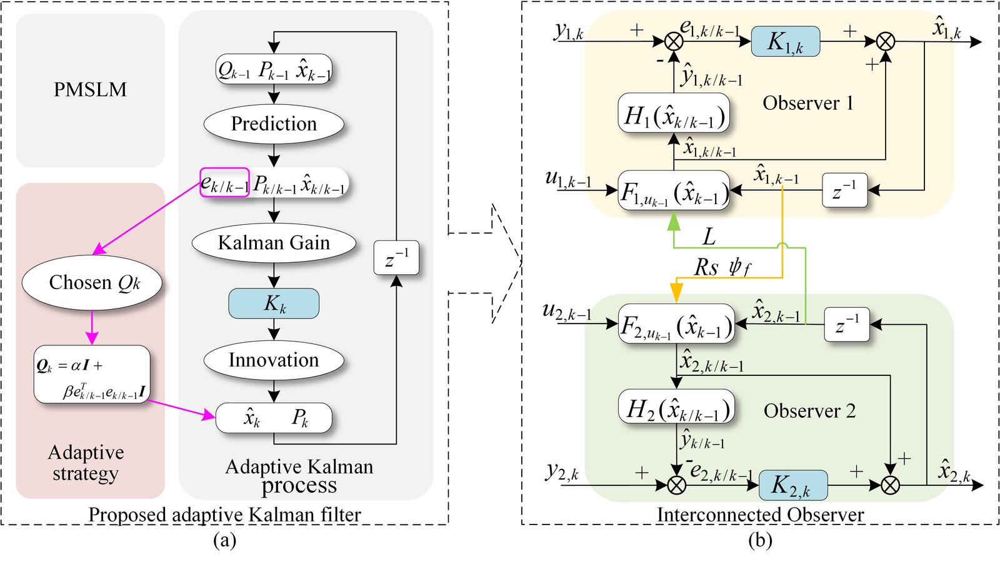








## 👋 About Me

I am a Ph.D. student at the School of Engineering Science / Institute of Humanoid Robotics, <a href="https://en.ustc.edu.cn/">University of Science and Technology of China (USTC)</a>, supervised by Prof. Shiwu Zhang and Dr. Wei Gao. I received my Bachelor's and Master's degrees from <a href="http://en.hfut.edu.cn/">Hefei University of Technology (HFUT)</a>.

My research focuses on **humanoid robotics** and **motor control**, applying advanced control theory to robotic systems — including model-based and learning-based locomotion control for humanoid robots, parameter identification, state estimation, and motor drives. I have published several academic papers (including co-authored works), listed below.

  Humanoid Robotics
  Joint Motor Control
  Control Theory &amp; Engineering
  Reinforcement Learning
  Parameter Identification &amp; State Estimation
  Linear Motor Drives

## 🎓 Education

- **2023.09 - Present**  
  <i class="fas fa-university" aria-hidden="true"></i> **University of Science and Technology of China (USTC)**, Hefei, China  
  Ph.D. Student, School of Engineering Science / Institute of Humanoid Robotics
- **2019.09 - 2022.06**  
  <i class="fas fa-university" aria-hidden="true"></i> **Hefei University of Technology (HFUT)**, Hefei, China  
  M.Eng. in Control Science and Engineering
- **2015.09 - 2019.07**  
  <i class="fas fa-university" aria-hidden="true"></i> **Hefei University of Technology (HFUT)**, Hefei, China  
  B.Eng. in Automation
{: .timeline}

## 📝 Publications & Patents

### Chinese Journal Papers

Proc. CSEE 2022

- **`Xiaohu Zhang`, Jiwen Zhao et al.**  
  "High Precision Anti-Disturbance Online Multi-Parameter Identification for Permanent Magnet Synchronous Linear Motor Based on Adaptive Interconnected Extended Kalman Observer," *Proceedings of the CSEE*, 2022, 42(12): 4571-4581.  
  `Annual Excellent Paper of CSEE (Top 5%)` `High Impact Paper of CNKI` EI

### English Papers

- arXiv 2026  
  **T. Huang, M. Zhao, Y. Gao, F. Yuan, J. Gu, `X. Zhang`, D. Zhao, S. Yan, Y. Wang, W. Gao and S. Zhang**  
  "Bionic Human-Motion Style Transfer for Physically Executable Whole-Body Control of Humanoid Robots," *arXiv preprint arXiv:2606.03536*, 2026.  
  [arXiv](https://arxiv.org/abs/2606.03536){: .paper-link}

- arXiv 2026  
  **T. Huang, F. Yuan, J. Gu, S. Fang, `X. Zhang`, Y. Wang, W. Gao and S. Zhang**  
  "Human2Humanoid: Physics-Aware Cross-Morphology Motion Retargeting for Humanoid Robots," *arXiv preprint arXiv:2606.03476*, 2026.  
  [arXiv](https://arxiv.org/abs/2606.03476){: .paper-link}

arXiv 2026 · SKATER
<video class="paper-media" muted loop playsinline preload="none" poster="/images/SKATER-poster.jpg"><source src="/images/SKATER.mp4" type="video/mp4"></video>

- **J. Gu, F. Yuan, W. Shi, T. Huang, H. Zhang, `X. Zhang`, Y. Wang, W. Gao and S. Zhang**  
  "SKATER: Synthesized Kinematics for Advanced Traversing Efficiency on a Humanoid Robot via Roller Skate Swizzles," *arXiv preprint arXiv:2601.04948*, 2026.  
  [arXiv](https://arxiv.org/abs/2601.04948){: .paper-link}

IROS 2024

- **H. Zhang#, `X. Zhang#`, J. Cheng, J. Hu, C. Ji, Y. Wang, Y. Jiang, Z. Han, W. Gao\* and S. Zhang\***  
  "Torque Ripple Reduction in Quasi-Direct Drive Motors Through Angle-Based Repetitive Learning Observer and Model Predictive Torque Controller," *2024 IEEE/RSJ International Conference on Intelligent Robots and Systems (IROS)*, Abu Dhabi, United Arab Emirates, pp. 3546-3552.  
  `Co-first author` Top robotics conference, EI  
  [IEEE](https://ieeexplore.ieee.org/document/10801721){: .paper-link}

ROBIO 2024 · Quadspine
<video class="paper-media" muted loop playsinline preload="none" poster="/images/quadspine-poster.jpg"><source src="/images/quadspine.mp4" type="video/mp4"></video>

- **J. Hu, W. Gao, `X. Zhang`, J. Cheng and S. Zhang**  
  "Predictive Control of a Spined Quadrupedal Robot Based on a Dual Rigid-Body Model," *2024 IEEE International Conference on Robotics and Biomimetics (ROBIO)*, pp. 292-298, 2024.  
  EI  
  [IEEE](https://ieeexplore.ieee.org/document/10907590){: .paper-link}

ROBIO 2024
<video class="paper-media" muted loop playsinline preload="none" poster="/images/telepresence-poster.jpg"><source src="/images/telepresence.mp4" type="video/mp4"></video>

- **T. Wang, Y. Zhu, `X. Zhang`, W. Gao and S. Zhang**  
  "A Telepresence Enhancing Method Based on Human Arm Dynamics," *2024 IEEE International Conference on Robotics and Biomimetics (ROBIO)*, pp. 1415-1421, 2024.  
  EI  
  [IEEE](https://ieeexplore.ieee.org/document/10907667){: .paper-link}

  Responsible for the hardware system design; along the way I learned PCB design and built two circuit board versions (STM32 and ESP32).
  {: .paper-note}

IEEE TPEL 2022

- **L. Wang, J. Zhao, X. Yang, Z. Zheng, `X. Zhang`, L. Wang**  
  "Robust Deadbeat Predictive Current Regulation for Permanent Magnet Synchronous Linear Motor Drivers With Parallel Parameter Disturbance and Load Observer," *IEEE Transactions on Power Electronics*, 2022, 37(7): 7834-7845.  
  CAS Top, IF: 5.967  
  [DOI](https://doi.org/10.1109/TPEL.2022.3142119){: .paper-link}

- IEEE TIM 2022  
  **D. Hu, J. Zhao, X. Yang, `X. Zhang`**  
  "Precision Motion Measurement for Linear Motor Based on FNCC and Phase Difference M-Estimator Robust Regression in a VLSM System," *IEEE Transactions on Instrumentation and Measurement*, 2022, 70: 5017310.  
  SCI, IF: 5.332  
  [DOI](https://doi.org/10.1109/TIM.2021.3125706){: .paper-link}

LDIA 2021
<video class="paper-media" muted loop playsinline preload="none" poster="/images/ldia2021-poster.jpg"><source src="/images/ldia2021.mp4" type="video/mp4"></video>

- **`X. Zhang`, J. Zhao et al.**  
  "Joint Kalman Observer for Mechanical Multi-parameter Decoupling Estimation of Permanent Magnet Synchronous Linear Motor," *2021 13th International Symposium on Linear Drives for Industry Applications (LDIA)*, 2021.  
  EI  
  [IEEE](https://ieeexplore.ieee.org/document/9505720){: .paper-link}

- IEEE TII 2020  
  **J. Song, J. Zhao, `X. Zhang` et al.**  
  "Accurate Demagnetization Faults Detection of Dual-Sided Permanent Magnet Linear Motor Using Enveloping and Time-Domain Energy Analysis," *IEEE Transactions on Industrial Informatics*, 2020, 16(10): 6334-6346.  
  CAS Top, IF: 11.648

### Projects

Full-size Humanoid 2024
<video class="paper-media" muted loop playsinline preload="none" poster="/images/humanoid-kick-poster.jpg"><source src="/images/humanoid-kick.mp4" type="video/mp4"></video>

- **`Xiaohu Zhang`, both, pocket et al.**  
  "MPC+WBC Based Motion Control for a Full-size Humanoid Robot," 2024 - Present.  
  Involved throughout in mechanical design iteration, electrical system design, low-level communication interfaces, and optimization of classical control algorithms.

### Patents

- **[P03] Locomotion Control Method for Legged Robots**  
  Wei Gao, Zhen Han, Yutong Jiang, Yongming Yue, `Xiaohu Zhang`, Yu Wang, Shiwu Zhang. Invention Patent, CN202411919748.1, Granted: 2025-01-24, Filed: 2024-12-25.
- **[P02] Torque Ripple Suppression Method for Quasi-Direct Drive Motors in Robot Joints**  
  Shiwu Zhang, `Xiaohu Zhang`, Hefei Zhang, Wei Gao. Invention Patent, CN202410747271.7, Under Examination, Filed: 2024-06-11.
- **[P01] Force Feedback Method and Device for Teleoperation System Based on Vibration Induction**  
  Shiwu Zhang, Yuewei Zhu, Tengda Wang, Wei Gao, `Xiaohu Zhang`, Yuanzhe Xie. Invention Patent, ZL202410471429.2, Granted: 2024-07-12, Filed: 2024-04-19.
{: .patent-list}

## 🏅 Honors and Awards

- **2025** `Gold Medal`, Anhui Province College Students Innovation Competition
- **2023** `Annual Excellent Paper of CSEE`
- **2023 - Present** Scholarship, University of Science and Technology of China
- **2022** First-Class Scholarship, Hefei University of Technology
- **2018** Second Prize, National University Intelligent Transportation Innovation and Entrepreneurship Competition
{: .timeline}

## 🏛️ Academic Conferences

- **Hangzhou, China** Attended `IROS 2025`
- **Abu Dhabi, UAE** Attended `IROS 2024` and gave an oral presentation
- **Wuhan, China** Attended `LDIA 2021` and presented a poster
- **Hefei, China** Attended the `World Manufacturing Convention` (2019, 2023, 2024)
- **Shenyang, China** Attended the China Robot Science Conference (`CCRS 2019`)
{: .timeline}

## 💻 Internships

- **2025.09** Intern, a humanoid robotics company, Wuhu, Anhui
- **2022 - 2023** Research Intern, Institute of Advanced Technology, USTC, Hefei, Anhui
{: .timeline}
