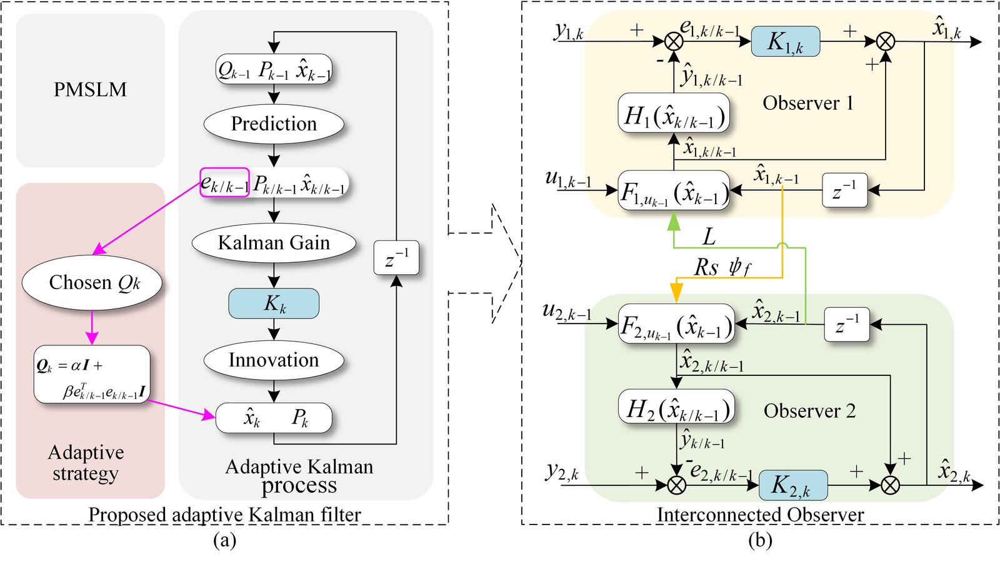








## 👋 关于我

我是 <a href="https://www.ustc.edu.cn/">中国科学技术大学</a> 工程科学学院 / 人形机器人研究院的在读博士研究生，导师为张世武教授和高纬老师；本科和硕士毕业于 <a href="https://www.hfut.edu.cn/">合肥工业大学</a>。

我的研究聚焦于人形机器人与电机控制，致力于将先进的控制理论应用于机器人系统，具体包括人形机器人基于模型与基于学习的运动控制、参数辨识、状态估计和电机驱动。包括合著在内，我已发表多篇学术论文，详见下方论文列表。

  人形机器人
  关节电机控制
  控制理论与控制工程
  强化学习
  参数辨识与状态估计
  直线电机驱动

## 🎓 学历

- **2023.09 - 至今**  
  <i class="fas fa-university" aria-hidden="true"></i> **中国科学技术大学** 工程科学学院 / 人形机器人研究院，安徽合肥  
  博士研究生
- **2019.09 - 2022.06**  
  <i class="fas fa-university" aria-hidden="true"></i> **合肥工业大学** 控制科学与工程，安徽合肥  
  工学硕士
- **2015.09 - 2019.07**  
  <i class="fas fa-university" aria-hidden="true"></i> **合肥工业大学** 自动化，安徽合肥  
  工学学士
{: .timeline}

## 📝 论文与专利

### 中文论文

中国电机工程学报 2022

- **`张晓虎`, 赵吉文 等**  
  "基于自适应互联扩展卡尔曼观测器的永磁同步直线电机高精度抗干扰在线多参数辨识," *中国电机工程学报*, 2022, 42(12): 4571-4581.  
  `中国电机工程学报年度优秀论文（TOP 5%）` `中国知网高影响力论文` EI

### 英文论文

- arXiv 2026  
  **T. Huang, M. Zhao, Y. Gao, F. Yuan, J. Gu, `X. Zhang`, D. Zhao, S. Yan, Y. Wang, W. Gao and S. Zhang**  
  "Bionic Human-Motion Style Transfer for Physically Executable Whole-Body Control of Humanoid Robots," *arXiv preprint arXiv:2606.03536*, 2026.  
  [arXiv](https://arxiv.org/abs/2606.03536){: .paper-link}

- arXiv 2026  
  **T. Huang, F. Yuan, J. Gu, S. Fang, `X. Zhang`, Y. Wang, W. Gao and S. Zhang**  
  "Human2Humanoid: Physics-Aware Cross-Morphology Motion Retargeting for Humanoid Robots," *arXiv preprint arXiv:2606.03476*, 2026.  
  [arXiv](https://arxiv.org/abs/2606.03476){: .paper-link}

arXiv 2026 · SKATER
<video class="paper-media" muted loop playsinline preload="none" poster="/images/SKATER-poster.jpg"><source src="/images/SKATER.mp4" type="video/mp4"></video>

- **J. Gu, F. Yuan, W. Shi, T. Huang, H. Zhang, `X. Zhang`, Y. Wang, W. Gao and S. Zhang**  
  "SKATER: Synthesized Kinematics for Advanced Traversing Efficiency on a Humanoid Robot via Roller Skate Swizzles," *arXiv preprint arXiv:2601.04948*, 2026.  
  [arXiv](https://arxiv.org/abs/2601.04948){: .paper-link}

IROS 2024

- **H. Zhang#, `X. Zhang#`, J. Cheng, J. Hu, C. Ji, Y. Wang, Y. Jiang, Z. Han, W. Gao\* and S. Zhang\***  
  "Torque Ripple Reduction in Quasi-Direct Drive Motors Through Angle-Based Repetitive Learning Observer and Model Predictive Torque Controller," *2024 IEEE/RSJ International Conference on Intelligent Robots and Systems (IROS)*, Abu Dhabi, United Arab Emirates, pp. 3546-3552.  
  `共同第一作者` 机器人顶会，EI  
  [IEEE](https://ieeexplore.ieee.org/document/10801721){: .paper-link}

ROBIO 2024 · Quadspine
<video class="paper-media" muted loop playsinline preload="none" poster="/images/quadspine-poster.jpg"><source src="/images/quadspine.mp4" type="video/mp4"></video>

- **J. Hu, W. Gao, `X. Zhang`, J. Cheng and S. Zhang**  
  "Predictive Control of a Spined Quadrupedal Robot Based on a Dual Rigid-Body Model," *2024 IEEE International Conference on Robotics and Biomimetics (ROBIO)*, pp. 292-298, 2024.  
  EI  
  [IEEE](https://ieeexplore.ieee.org/document/10907590){: .paper-link}

ROBIO 2024
<video class="paper-media" muted loop playsinline preload="none" poster="/images/telepresence-poster.jpg"><source src="/images/telepresence.mp4" type="video/mp4"></video>

- **T. Wang, Y. Zhu, `X. Zhang`, W. Gao and S. Zhang**  
  "A Telepresence Enhancing Method Based on Human Arm Dynamics," *2024 IEEE International Conference on Robotics and Biomimetics (ROBIO)*, pp. 1415-1421, 2024.  
  EI  
  [IEEE](https://ieeexplore.ieee.org/document/10907667){: .paper-link}

  在这个项目里负责硬件系统设计，过程中也是第一次学习并完成 STM32 和 ESP32 两版电路 PCB 的设计与加工，记录一下。
  {: .paper-note}

IEEE TPEL 2022

- **L. Wang, J. Zhao, X. Yang, Z. Zheng, `X. Zhang`, L. Wang**  
  "Robust Deadbeat Predictive Current Regulation for Permanent Magnet Synchronous Linear Motor Drivers With Parallel Parameter Disturbance and Load Observer," *IEEE Transactions on Power Electronics*, 2022, 37(7): 7834-7845.  
  中科院 TOP，IF: 5.967  
  [DOI](https://doi.org/10.1109/TPEL.2022.3142119){: .paper-link}

- IEEE TIM 2022  
  **D. Hu, J. Zhao, X. Yang, `X. Zhang`**  
  "Precision Motion Measurement for Linear Motor Based on FNCC and Phase Difference M-Estimator Robust Regression in a VLSM System," *IEEE Transactions on Instrumentation and Measurement*, 2022, 70: 5017310.  
  SCI，IF: 5.332  
  [DOI](https://doi.org/10.1109/TIM.2021.3125706){: .paper-link}

LDIA 2021
<video class="paper-media" muted loop playsinline preload="none" poster="/images/ldia2021-poster.jpg"><source src="/images/ldia2021.mp4" type="video/mp4"></video>

- **`X. Zhang`, J. Zhao et al.**  
  "Joint Kalman Observer for Mechanical Multi-parameter Decoupling Estimation of Permanent Magnet Synchronous Linear Motor," *2021 13th International Symposium on Linear Drives for Industry Applications (LDIA)*, 2021.  
  EI  
  [IEEE](https://ieeexplore.ieee.org/document/9505720){: .paper-link}

- IEEE TII 2020  
  **J. Song, J. Zhao, `X. Zhang` et al.**  
  "Accurate Demagnetization Faults Detection of Dual-Sided Permanent Magnet Linear Motor Using Enveloping and Time-Domain Energy Analysis," *IEEE Transactions on Industrial Informatics*, 2020, 16(10): 6334-6346.  
  中科院 TOP，IF: 11.648

### 工程项目

全尺寸人形机器人 2024
<video class="paper-media" muted loop playsinline preload="none" poster="/images/humanoid-kick-poster.jpg"><source src="/images/humanoid-kick.mp4" type="video/mp4"></video>

- **`张晓虎`, both, pocket 等**  
  "基于 MPC+WBC 的全尺寸人形机器人运动控制"，2024 - 至今。  
  全程参与人形机器人机械部分迭代优化、电气系统设计、下位机通信接口与传统控制算法优化。

### 专利

- **[P03] 一种腿式机器人的移动控制方法**  
  高纬，韩震，姜雨彤，岳永铭，`张晓虎`，王煜，张世武。发明专利，CN202411919748.1，授权日期：2025-01-24，申请日期：2024-12-25。  
- **[P02] 一种机器人关节准直驱电机转矩波动抑制方法**  
  张世武，`张晓虎`，张贺飞，高纬。发明专利，CN202410747271.7，实审中，申请日期：2024-06-11。  
- **[P01] 基于振动诱导的用于遥操作系统的力反馈方法及装置**  
  张世武，朱阅微，王腾达，高纬，`张晓虎`，谢远哲。发明专利，ZL202410471429.2，授权日期：2024-07-12，申请日期：2024-04-19。
{: .patent-list}

## 🏅 荣誉奖项

- **2025** 安徽省大学生创新大赛 `金奖`
- **2023** `中国电机工程学报年度优秀论文`
- **2023 - 至今** 中国科学技术大学 奖学金
- **2022** 合肥工业大学 一等奖学金
- **2018** 全国高校智能交通创新与创业大赛 二等奖
{: .timeline}

## 🏛️ 学术会议

- **中国杭州** 参加 `IROS 2025` 国际会议
- **阿联酋阿布扎比** 参加 `IROS 2024` 国际会议并做 Oral 报告
- **中国武汉** 参加 `LDIA 2021` 国际会议并做海报展示
- **中国合肥** 参加 2019、2023、2024 `世界制造业大会`
- **中国沈阳** 参加中国机器人学术年会（`CCRS 2019`）
{: .timeline}

## 💻 工作实习

- **2025.09** 人形机器人企业，实习，安徽芜湖
- **2022 - 2023** 中国科学技术大学先进技术研究院，研究实习员，安徽合肥
{: .timeline}
